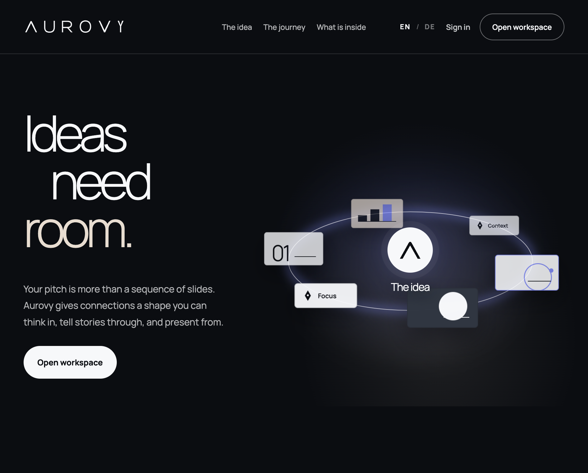
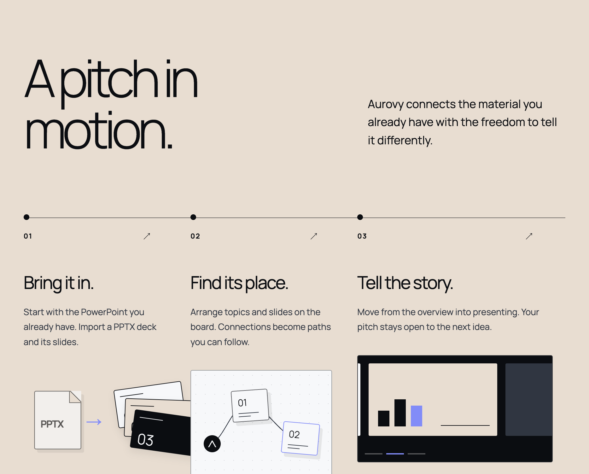
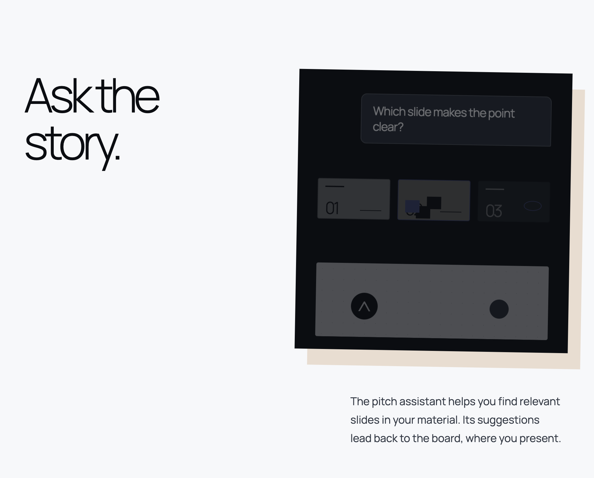

  

# Aurovy

**Ideas need room.**

Aurovy is a **spatial presentation** product: import the PowerPoint you already have, arrange slides and topics on a living board, present from the overview — and ask a pitch assistant when you need the right slide.

Try the hosted product at **[aurovy.app](https://aurovy.app)**.

  

<em>Landing — spatial board as the shape of a pitch</em>

---

## Why Aurovy

Most decks stay a stack of slides. Aurovy gives connections a place to live:

- **Spatial board** — topics, slides, and paths on one canvas (not only linear click-through)
- **PPTX ingest** — bring existing PowerPoint material into the board
- **Presentation mode** — move from overview into the moment without losing the map
- **Pitch assistant** — ask the story; suggestions lead back to slides on the board
- **Standalone product** — no suite federation, no Plexon lock-in

  

<em>Journey — import → place → present</em>

  

<em>Pitch assistant — find the slide that makes the point</em>

---

## What’s inside

| Area | What you get |
|------|----------------|
| **Board** | Canvas2D spatial presentation surface — nodes, slides, connections |
| **Ingest** | PPTX upload (LibreOffice + raster pipeline in Docker) |
| **Present** | Fullscreen / presentation flow from the board |
| **Assistant** | Pitch chat over your deck materials (`/api/assistant/chat`) |
| **People** | Local accounts, roles, invites, system mail |
| **Brand** | Aurovy Brand Kit — Aurora / Midnight / Sand / Cloud · Manrope |

---

## Status of this repo

This is the **public community surface** under [aurovylabs](https://github.com/aurovylabs) (**delivery only** — not the private product tree).

| Today | Next |
|-------|------|
| Product story, brand marks, landing screenshots | Full developable AGPL / self-host pack (same pattern as [zaoly-delivery](https://github.com/aurovylabs/zaoly-delivery)) |

Until the pack lands: use **[aurovy.app](https://aurovy.app)** for the live product. Watch this repo for clone / Docker / self-host instructions.

---

## Links

| | |
|--|--|
| Product | [aurovy.app](https://aurovy.app) |
| Org | [github.com/aurovylabs](https://github.com/aurovylabs) |
| Sister product | [Zaoly](https://github.com/aurovylabs/zaoly-delivery) — design → reusable React components |

---

## License

Community pack license will ship with the developable tree (AGPL-oriented, aligned with Zaoly delivery). Brand assets in `brand/` remain product trademarks — use them to represent Aurovy, not as a generic mark.
